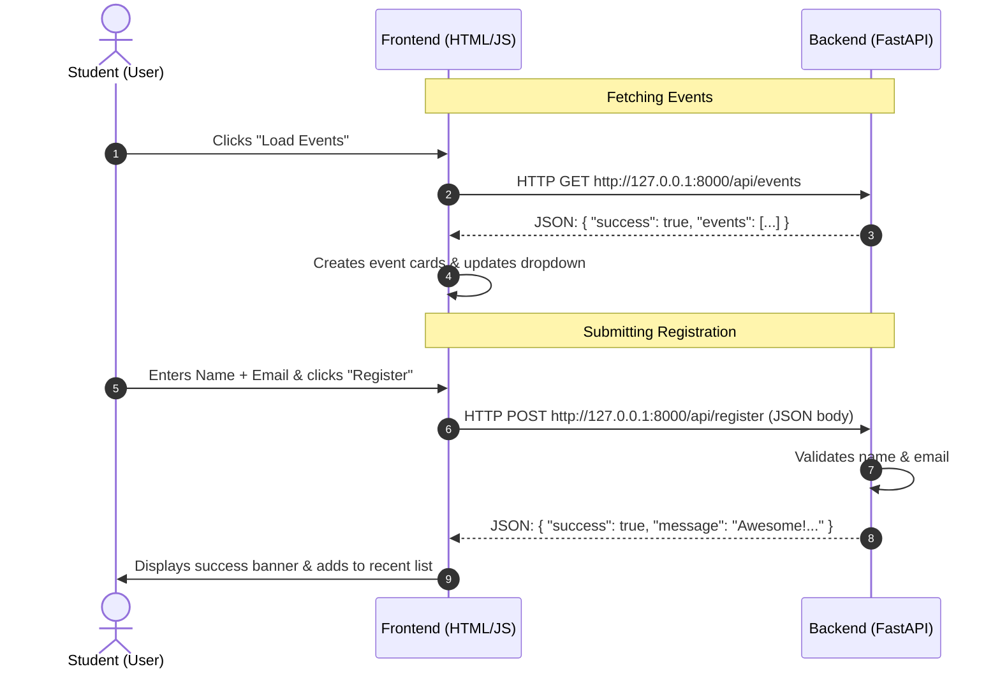

# 🎓 Student Tech Hub

A beginner-friendly, lightweight full-stack web application designed for students, clubs, and campus tech communities.

It allows students to browse upcoming technical workshops, hackathons, and webinars, as well as register for events in real time.

---

## 🌟 What This Project Does

The **Student Tech Hub** demonstrates the fundamentals of modern full-stack web development:

1. **Frontend (Client)**: A clean, modern, and responsive user interface built using **plain HTML, CSS, and JavaScript** (no React, Next.js, or complex frameworks required).
2. **Backend (Server)**: A fast, lightweight REST API built with **Python and FastAPI**.
3. **Data Communication**: Seamless communication between frontend and backend using standard browser `fetch()` requests and JSON data, with **CORS** (Cross-Origin Resource Sharing) enabled.
4. **Key Features**:
   - 📌 Interactive "Load Events from Backend" button that queries `GET /api/events`.
   - 🏷️ Real-time category filtering (Web Dev, AI & ML, Hackathons, Cloud, Open Source).
   - 📝 Student Registration form submitting name and email to `POST /api/register`.
   - ⚡ Real-time backend status indicator showing whether the FastAPI server is reachable.
   - 📖 Interactive Swagger API documentation powered by FastAPI.

---

## 📁 Project Structure

```text
student-tech-hub/
├── frontend/
│   ├── index.html       # Web page structure, semantic HTML5, and accessible forms
│   ├── style.css        # Clean modern CSS styling with responsive grid and flexbox
│   └── script.js        # Plain JavaScript handling API calls (fetch), DOM updates, and events
├── backend/
│   ├── main.py          # Python FastAPI application with CORS and REST endpoints
│   └── requirements.txt # Python dependencies (fastapi and uvicorn)
└── README.md            # Comprehensive project documentation and guides
```

---

## 🛠️ Prerequisites

Before you start, make sure you have **Python 3.8 or newer** installed on your computer.

You can verify Python is installed by running:

```bash
python --version
```

*(On macOS/Linux, you might use `python3 --version`)*

---

## 🚀 Step 1: Install & Set Up the Backend

1. **Open your terminal or command prompt** and navigate into the `backend` folder:

   ```bash
   cd backend
   ```

2. *(Optional, Recommended)* **Create and activate a virtual environment**:
   - On **Windows**:
     ```powershell
     python -m venv venv
     .\venv\Scripts\activate
     ```
   - On **macOS / Linux**:
     ```bash
     python3 -m venv venv
     source venv/bin/activate
     ```

3. **Install the required packages**:

   ```bash
   python -m pip install -r requirements.txt
   ```

   > 💡 The `requirements.txt` installs only two lightweight libraries:
   > - `fastapi`: High-performance Python web framework for building APIs.
   > - `uvicorn`: Lightning-fast ASGI server that runs FastAPI.

---

## ▶️ Step 2: Run the Backend Server

Inside the project root or the `backend` folder, run:

```bash
python -m uvicorn backend.main:app --reload --port 8000
```

*(If you are already inside the `backend/` folder, run `python -m uvicorn main:app --reload --port 8000`)*

### 🔍 How to check the backend is working:
- Open your browser and visit: **[http://127.0.0.1:8000](http://127.0.0.1:8000)** (You will see a welcome JSON message).
- Check the event data: **[http://127.0.0.1:8000/api/events](http://127.0.0.1:8000/api/events)**
- Explore the interactive API docs: **[http://127.0.0.1:8000/docs](http://127.0.0.1:8000/docs)**

---

## 💻 Step 3: Run the Frontend Locally

Running the frontend requires **no npm or build steps**! You have three easy ways:

### Option A (Simplest - Direct File Open):
1. Navigate to the `frontend` folder in your file explorer.
2. Double-click **`index.html`** to open it in your favorite browser (Chrome, Edge, Firefox, Safari).

### Option B (Using Python's Built-in HTTP Server):
In a separate terminal window, navigate to the `frontend` directory and run:

```bash
cd frontend
python -m http.server 3000
```
Then visit **[http://127.0.0.1:3000](http://127.0.0.1:3000)** in your browser.

### Option C (VS Code Live Server):
If you use VS Code, right-click `frontend/index.html` and choose **"Open with Live Server"**.

---

## 🌐 How the Frontend Communicates with the Backend

This application illustrates how modern client-server architectures operate:



### 1. `GET /api/events` (Loading Events)
- **Frontend action**: In [`script.js`](file:///C:/Users/Farhan%20sayyed/OneDrive/Desktop/student%20tech%20hub/frontend/script.js), clicking the "Load Events" button executes:
  ```javascript
  const response = await fetch('http://127.0.0.1:8000/api/events');
  const data = await response.json();
  ```
- **Backend response**: In [`main.py`](file:///C:/Users/Farhan%20sayyed/OneDrive/Desktop/student%20tech%20hub/backend/main.py), FastAPI sends back a list of events in JSON format.
- **DOM update**: JavaScript loops through `data.events` and creates HTML card elements to display dates, descriptions, categories, and speakers on the page.

### 2. `POST /api/register` (Registering a Student)
- **Frontend action**: When the student submits the form, JavaScript collects `name` and `email` and sends them as JSON:
  ```javascript
  const response = await fetch('http://127.0.0.1:8000/api/register', {
    method: 'POST',
    headers: { 'Content-Type': 'application/json' },
    body: JSON.stringify({ name: name, email: email, event_id: eventId })
  });
  ```
- **Backend processing**: FastAPI receives the JSON payload, checks that both the name and a valid email are present using a Pydantic `StudentRegistration` model, and returns a confirmation message.
- **User feedback**: The UI displays a notification and lists the student under "Recent Session Registrations".

### 3. Why CORS is Enabled
Because the frontend runs either from `file://` or a local port like `http://127.0.0.1:3000`, and the backend runs on `http://127.0.0.1:8000`, the browser treats them as **different origins**. 

Without CORS, the browser blocks the frontend from reading the backend response. In `backend/main.py`, CORS is enabled with:

```python
from fastapi.middleware.cors import CORSMiddleware

app.add_middleware(
    CORSMiddleware,
    allow_origins=["*"],       # Allows frontend requests from any port or file://
    allow_credentials=True,
    allow_methods=["*"],
    allow_headers=["*"],
)
```

---

## 📡 API Endpoints Reference

| Method | Endpoint | Description | Sample Request Body | Sample Response |
| :--- | :--- | :--- | :--- | :--- |
| `GET` | `/` | API status & welcome message | None | `{"status": "healthy"}` |
| `GET` | `/api/events` | List all upcoming tech events | None | `{"success": true, "events": [...]}` |
| `POST` | `/api/register` | Register a student | `{"name": "Alice", "email": "alice@school.edu"}` | `{"success": true, "message": "Awesome, Alice!..."}` |
| `GET` | `/api/registrations`| View all in-memory registrations | None | `{"count": 1, "registrations": [...]}` |
| `GET` | `/docs` | Interactive Swagger UI | None | Interactive Documentation |

---

## 💡 Beginner Troubleshooting

| Problem | Cause | Solution |
| :--- | :--- | :--- |
| **"Could not connect to backend server"** error in frontend | The FastAPI server is not currently running. | Start the server with `python -m uvicorn backend.main:app --reload --port 8000` |
| **`python` or `pip` is not recognized** | Python is not added to your system PATH. | Re-run the Python installer and check the box **"Add Python to PATH"**, or use `py` / `python3`. |
| **Changes to `main.py` aren't showing** | The server was not launched with `--reload`. | Make sure to include the `--reload` flag so uvicorn auto-restarts when files change. |

---

## 📜 License & Usage

Created for educational purposes. Feel free to use, modify, and extend this project for student clubs, workshops, and hackathons!
